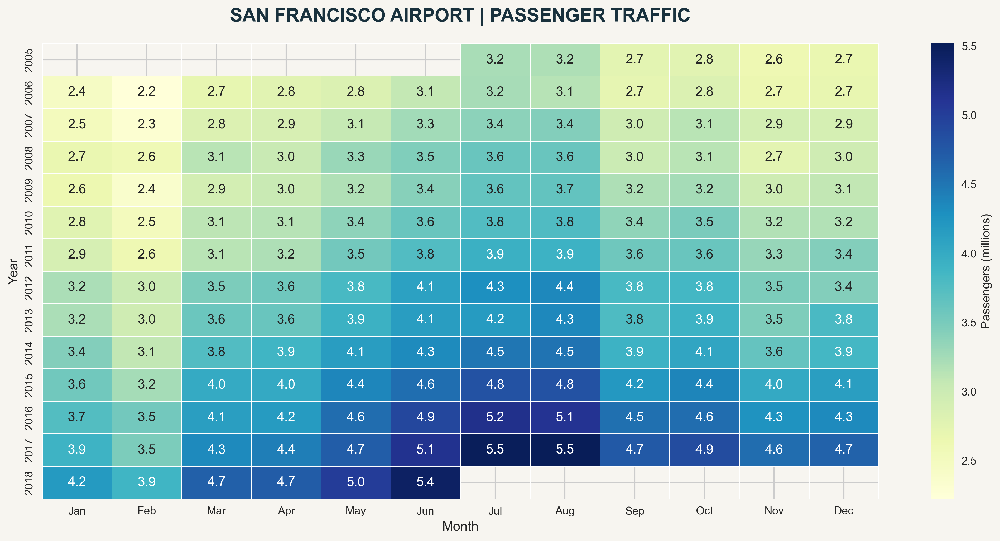
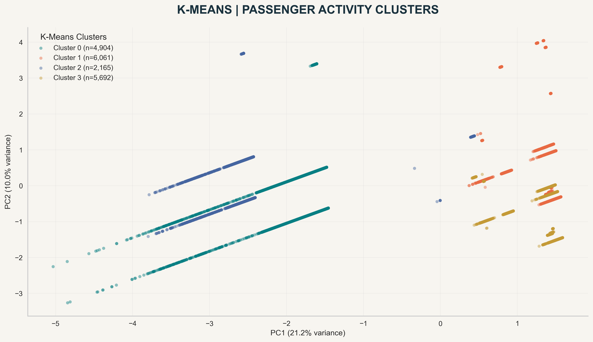
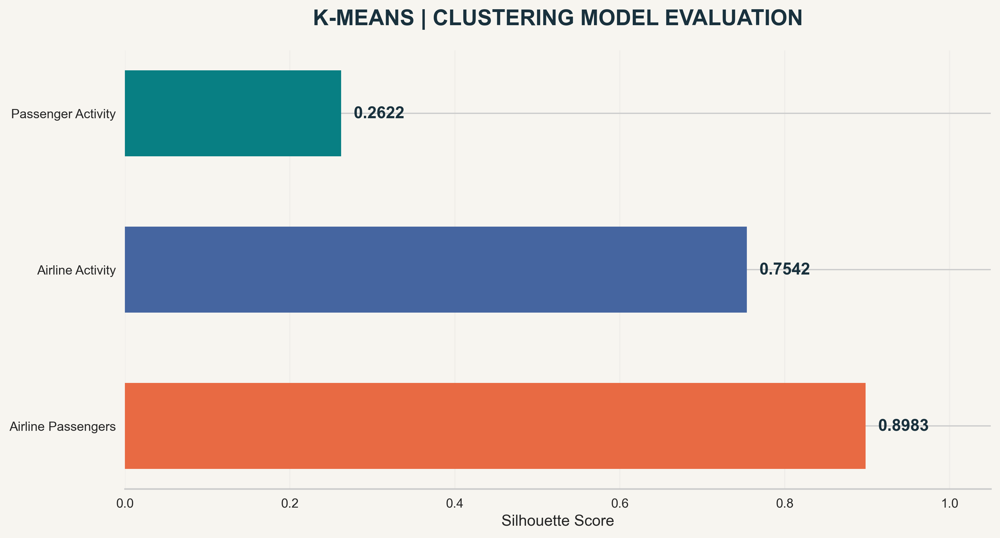
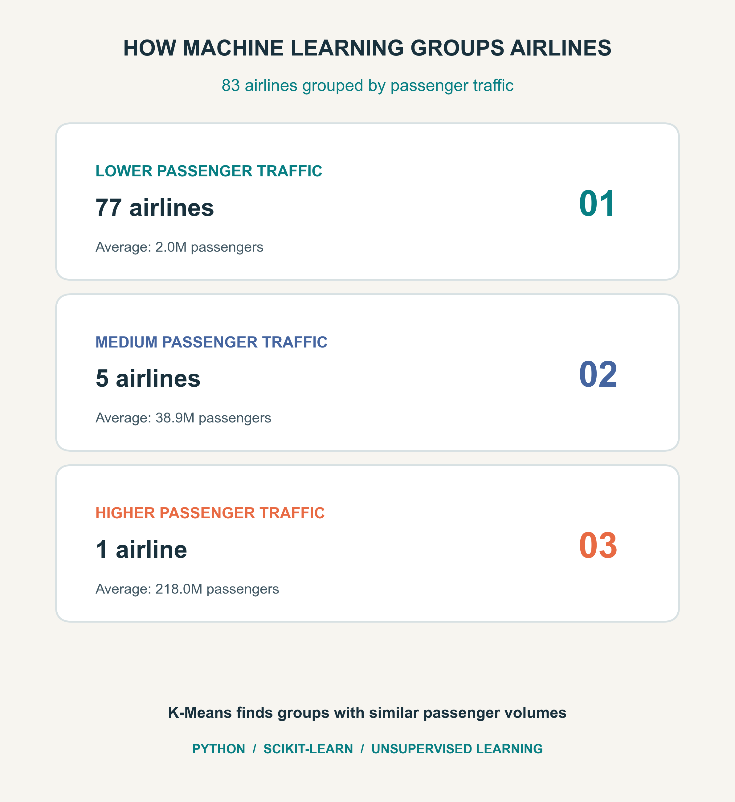

# ✈️ San Francisco Airport – Passenger & Airline Clustering

### Unsupervised Machine Learning | K-Means | Python

## 📌 Project Overview

This project explores passenger traffic and airline activity at **San Francisco International Airport (SFO)** using **K-Means Clustering**.

The goal is to discover patterns in aviation data and group similar observations without predefined target labels.

Three clustering models were developed to analyze passenger activity, airline record frequency, and total passenger volume.

## 🎯 Project Objectives

- Explore and preprocess airport passenger data.
- Identify patterns in airline and passenger activity.
- Apply K-Means Clustering using different feature sets.
- Evaluate cluster separation using Silhouette Scores.
- Visualize and interpret the results.

## 🛠️ Technologies Used

- **Python** – Data analysis and machine learning
- **Pandas & NumPy** – Data preprocessing
- **Scikit-learn** – K-Means, StandardScaler, Silhouette Score
- **Matplotlib & Seaborn** – Data visualization
- **Yellowbrick** – Elbow Method

## 🤖 Machine Learning Models

| Model | Clusters | Silhouette Score |
|---|---:|---:|
| Passenger Activity Clustering | 4 | 0.2414 |
| Airline Activity Clustering | 4 | 0.7542 |
| Airline Passenger Clustering | 3 | 0.8983 |

### 1. Passenger Activity Clustering

Groups passenger activity records based on geographic characteristics, activity types, price categories, and passenger counts.

**Result:** Four clusters with a Silhouette Score of 0.2414, indicating relatively weak cluster separation.

### 2. Airline Activity Clustering

Groups airlines based on the number of records associated with each airline in the dataset.

**Result:** Four clusters with a Silhouette Score of 0.7542.

### 3. Airline Passenger Clustering

Groups airlines according to their total recorded passenger volume.

**Result:** Three clusters with a Silhouette Score of 0.8983, indicating strong separation for the selected feature.

*Note: The models use different features, so their Silhouette Scores should not be interpreted as a direct overall performance ranking.*

## 📊 Data Visualization

### 1. Passenger Traffic Heatmap

Monthly passenger traffic patterns at San Francisco International Airport.



### 2. K-Means Cluster Visualization

Two-dimensional PCA visualization of passenger activity clusters.



### 3. Clustering Model Comparison

Silhouette Scores for the three K-Means clustering approaches.




The analysis includes:

- Monthly passenger traffic trends
- Passenger traffic heatmaps
- K-Means cluster visualizations
- Airline activity and passenger rankings
- Elbow Method charts


## ✈️ Project Highlights

This project explores passenger traffic and airline activity at San Francisco International Airport using Python, data analysis, and K-Means clustering.

### 1. Project Overview

An introduction to the main questions explored in this project.


### 2. When Is San Francisco Airport Busiest?

The analysis shows that August has the highest average passenger traffic in the dataset, at approximately 4.1 million passengers.


### 3. How Machine Learning Groups Airlines

K-Means clustering identified three groups based on recorded passenger volumes:

- **77 airlines:** Lower passenger traffic, averaging 2.0 million passengers.
- **5 airlines:** Medium passenger traffic, averaging 38.9 million passengers.
- **1 airline:** Higher passenger traffic, with 218.0 million passengers.

These figures represent passenger volumes across the dataset period, not annual passenger totals.



---

## 🔬 Technical Analysis

The Jupyter Notebook contains the detailed data analysis, clustering models, evaluation metrics, and additional visualizations.


## 📁 Repository Structure

```text
SanFranciscoAirportClustering/
├── README.md
└── notebooks/
    └── SanFranciscoAirportClustering.ipynb
```

## 📈 Key Takeaways

- K-Means can reveal different patterns in airport passenger and airline data.
- Feature selection and standardization influence clustering results.
- Airline-level clustering produced more clearly separated groups than the passenger activity model.
- Data visualization helps explain and interpret clustering outcomes.

## 🔮 Future Improvements

- Compare K-Means with DBSCAN and Hierarchical Clustering.
- Explore alternative feature combinations.
- Investigate cluster characteristics in greater detail.
- Improve visualizations and model evaluation.

## 👨‍💻 Author

Developed by **EnYa32**

GitHub: https://github.com/EnYa32

---

*This project is part of my Data Science and Machine Learning portfolio.*
